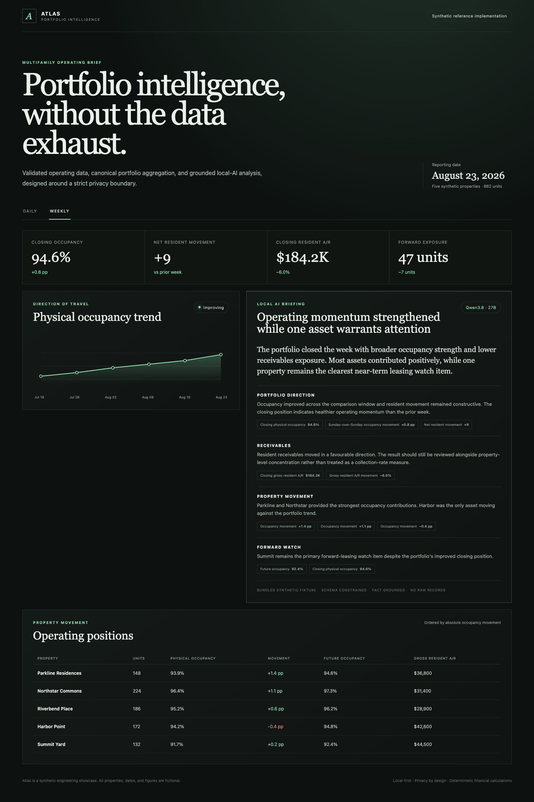
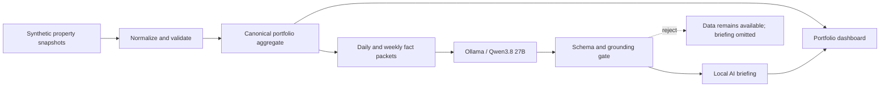

# Atlas: Local-First Portfolio Intelligence

[](https://github.com/rgb101593/local-first-portfolio-intelligence/actions/workflows/ci.yml)


A TypeScript reference implementation for turning property snapshots into validated operating metrics, daily and weekly portfolio views, and grounded local-AI briefings.

> **Portfolio-project boundary:** this public repository is a synthetic engineering showcase. Every property, date, figure, and AI briefing is fictional. It contains no customer data, private deployment configuration, or production history.



## Review it in sixty seconds

| Discipline           | Evidence in the repository                                                                                    |
| -------------------- | ------------------------------------------------------------------------------------------------------------- |
| Product engineering  | Responsive daily/weekly React experience, strict shared contracts, accessibility state, production build      |
| Data engineering     | Same-date validation, duplicate rejection, canonical ordering, content hashing, weighted portfolio ratios     |
| AI engineering       | Native Ollama structured output, Qwen3.8 adapter, fact citations, provenance, adversarial evaluation fixtures |
| Security engineering | Aggregate-only prompt boundary, loopback-only inference, no model-authored figures, clean-history secret scan |

Start with [`src/pipeline/normalize.ts`](src/pipeline/normalize.ts), [`src/ai/ollama.ts`](src/ai/ollama.ts), and the [engineering case study](docs/case-study.md).

## Why this project exists

Property teams often reconcile spreadsheet flexibility with dashboard consistency. Atlas keeps the calculation boundary explicit and preserves the context needed to interpret movement:

- deterministic calculations remain authoritative;
- daily and weekly views share one typed metric vocabulary;
- local AI explains supplied facts but cannot invent financial figures;
- raw resident and unit records remain outside the public-data boundary;
- failures degrade the narrative layer without blocking portfolio publication.

## What is implemented

- Responsive React portfolio dashboard with daily and weekly operating views
- Synthetic five-property dataset and historical occupancy trend
- Deterministic property-snapshot normalization and weighted portfolio aggregation
- Canonical source hashing, duplicate rejection, and mixed-date rejection
- Strict Zod contracts for analysis packets and model responses
- Native Ollama `/api/chat` integration targeting `qwen3.8:27b`
- JSON Schema-constrained generation at temperature zero
- Claim grounding through allowlisted fact IDs
- Rejection of model-authored numbers, currency amounts, dates, and percentages
- Code-owned model, prompt, input-hash, and timestamp provenance
- Fail-closed tests for unknown citations, period mismatch, malformed output, and model failure
- Committed adversarial AI evaluation suite with a machine-readable report
- Enforced coverage thresholds and CI for formatting, linting, evaluation, typecheck, and build

## Architecture



The public demo starts with synthetic property snapshots. Vendor file parsing, persistence, authentication, and cloud deployment remain outside this standalone repository.

## The local-AI safety pattern

The model does **not** calculate occupancy, receivables, exposure, or movement. It receives an allowlisted packet such as:

```json
{
  "id": "portfolio.occupancy.delta",
  "scope": "Portfolio",
  "label": "Sunday-over-Sunday occupancy movement",
  "displayValue": "+0.8 pp",
  "direction": "positive",
  "context": "Broad improvement in closing position"
}
```

Qwen writes qualitative narrative and cites the supporting fact IDs. Atlas rejects any narrative containing model-authored digits or financial symbols. The UI then renders exact values from the deterministic fact packet beside each narrative section.

The implementation assigns each responsibility to one boundary:

| Concern                                | Owner                          |
| -------------------------------------- | ------------------------------ |
| Calculations and financial definitions | Deterministic application code |
| Data lineage and publication identity  | Application/database           |
| Narrative synthesis                    | Local model                    |
| Numbers displayed to a stakeholder     | Deterministic renderer         |
| Approval and release policy            | Human/operator workflow        |

## Run the dashboard

Requirements: Node.js 24 or 25 and npm 11.

```bash
npm ci
npm run dev
```

Production verification:

```bash
npm run check
```

Run the AI contract evaluation separately when reviewing model safeguards:

```bash
npm run eval:ai
```

## Run local Qwen analysis

Install [Ollama](https://ollama.com/) and pull the official Qwen model:

```bash
ollama pull qwen3.8:27b
npm run insights:demo -- weekly
npm run insights:demo -- daily
```

Optional configuration:

```bash
export OLLAMA_BASE_URL=http://127.0.0.1:11434
export OLLAMA_MODEL=qwen3.8:27b
```

The adapter uses Ollama's native structured-output support. No cloud model, API key, LangChain runtime, or OpenClaw dependency is required.

## Engineering decisions

- **Direct Ollama over an agent framework:** one bounded inference call does not justify a tool graph.
- **TypeScript end to end:** contracts are shared across the UI, tests, and local inference boundary.
- **Structured output over prompt parsing:** JSON Schema and Zod provide two independent validation layers.
- **Aggregate facts only:** raw records never enter the model context or web application.
- **Narrative is optional:** local-model latency or failure cannot block the deterministic dashboard.
- **Synthetic public edition:** clean Git history is safer than attempting to redact a private production repository.

See the [engineering case study](docs/case-study.md), [architecture](docs/architecture.md), [threat model](docs/threat-model.md), and [ADR 001](docs/adr/001-grounded-local-ai.md).

## Repository map

```text
src/
├── ai/          # Ollama adapter, schemas, grounding, tests, CLI demo
├── data/        # Synthetic portfolio facts and sample briefing
├── domain/      # UI-facing domain types
├── pipeline/    # Normalization, weighted aggregation, canonical identity
├── App.tsx      # Daily/weekly portfolio experience
└── styles.css   # Responsive presentation system
docs/
├── adr/         # Architectural decision records
├── architecture.md
├── case-study.md
└── threat-model.md
```

## License

MIT. See [LICENSE](LICENSE).
